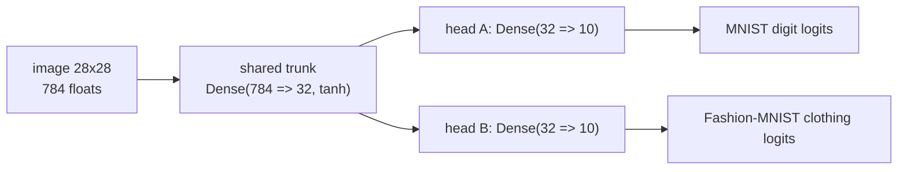

# Phase K: conditional-graph DDP on MNIST/Fashion-MNIST

Supervisor report. Date: 2026-10-05. Campaign hosts: `deathstar` and `leonardo`.

Status: K1 and K2 pass every executed cell on `deathstar` (CPU/MPI at 2 and 4
ranks; native CUDA/NCCL at 2 ranks) and on `leonardo` (native CUDA/NCCL at
4 ranks, fresh roots). No Flux source changed. The optional live
one-versus-four A100 timing stretch is complete and corrected (correctness
preflight PASS; 5/5 timed repeats each mode; ratio-of-medians diagnostic
speedups: training-only 1.888594, total 1.397335; the earlier instrumented
total 1.480203 is superseded;
`conditional-graph-phase-k-timing-stretch.md`). The deferred-behavior report is
unrun.

## 1. Purpose

Evaluate conditional-graph distributed training in Flux.jl at dataset level with
a supervisor demonstration:

- one shared trunk with two task-specific heads, where known dataset identity
  selects exactly one head per batch;
- task-conditioned routing with local and global head absence, including
  reactivation after nonzero Adam history;
- per-update comparison against an independent single-process native Adam
  reference that consumes the same saved multi-rank schedule;
- fresh-process checkpoint continuation;
- reproducible learning curves, learning-rate, discrepancy, schedule, and
  prediction figures.

Learning curves illustrate learning only. Per-step reference agreement supplies
the correctness evidence.

## 2. Model and distributed schedule



Task mapping: `head_a` = MNIST digits, `head_b` = Fashion-MNIST clothing.
Native Adam is fixed at `eta = 1e-3`, `beta = (0.9, 0.999)`, `epsilon = 1e-8`.
The initial fixture excludes dropout, augmentation, BatchNorm, and learned
routing. Global batch 128; local batch 64 (2 ranks) or 32 (4 ranks).

The saved six-step routing cycle:

| Cycle step | Rank 0 | Other ranks | Purpose |
|---|---|---|---|
| 1 | A | B | local absence and one-versus-rest weighting |
| 2 | A | B | nonzero Adam history on both heads |
| 3 | A | A | B globally absent after prior activity |
| 4 | B | B | A globally absent after prior activity |
| 5 | A | B | reactivation after absence |
| 6 | B | A | reversed participation |

Every rank computes its scheduled shard and the wrapper averages over all
ranks, including ranks where the head is absent. At 4 ranks, steps 1, 2, and 5
route A to 1 of 4 ranks and B to 3 of 4, so the routed objective differs from
the 2-rank run by rank count, as anticipated. A run is compared only with its
own schedule-matched reference. Exposures: 2 ranks 7680/7680 (both tasks);
4 ranks 6400 (A) and 8960 (B).

## 3. Correctness evidence

All summaries report `status PASS`; all exit codes are driver exit codes.
"Maxima" are `peer_param_maxerr` / `peer_mom1_maxerr` / `peer_mom2_maxerr`.

| Configuration | Train / resume exit | Elapsed train / resume | Maxima train (param / mom1 / mom2) | Maxima resume | resume_match | Driver |
|---|---|---|---|---|---|---|
| K2 smoke2 mpi2, 6 steps | 0 / 0 | 48.169 s / 46.661 s | 0.0 / 0.0 / 0.0 | 0.0 / 0.0 / 0.0 | 8 / 8 | 8/8 |
| K2 full mpi2, 120 steps | 0 / 0 | 53.684 s / 51.176 s | 0.0 / 0.0 / 0.0 | 0.0 / 0.0 / 0.0 | 236 / 236 | full MPI 13/13 |
| K2 full mpi4, 120 steps | 0 / 0 | 56.198 s / 56.699 s | 7.451e-09 / 9.313e-10 / 9.095e-12 | 5.960e-08 / 7.451e-09 / 7.276e-12 | 472 / 472 | full MPI 13/13 |
| K2 nccl2, 120 steps | 0 / 0 | 80.302 s / 78.773 s | 0.0 / 0.0 / 0.0 | 0.0 / 0.0 / 0.0 | 236 / 236 | 6/6 |
| K2 nccl4, 120 steps (leonardo) | 0 / 0 | 184.657 s / 77.235 s | 5.960e-08 / 4.657e-09 / 1.455e-11 | 5.960e-08 / 4.657e-09 / 1.455e-11 | 472 / 472 | 6/6 |
| K1 toy regression nccl4, 16 steps (leonardo) | 0 / 0 | 183.574 s / 67.707 s | 2.980e-08 / 2.980e-08 / 1.164e-10 | 2.980e-08 / 2.980e-08 / 1.164e-10 | 56 / 56 | 8/8 |
| K1 toy regression mpi2, 16 steps | 0 / 0 | 49.170 s / 47.665 s | 0.0 / 0.0 / 0.0 | 0.0 / 0.0 / 0.0 | 28 / 28 | 8/8 |

Declared tolerances before the runs: Float64 `atol=1e-12`, `rtol=1e-10`;
Float32 `atol=2e-6`, `rtol=1e-5`; structural, metadata, update-count, and
absent-state checks exact. The non-zero maxima are Float32 four-rank
accumulation differences inside those tolerances: the deathstar mpi4 row and
the Leonardo nccl4 rows. The mpi2 and 2-rank NCCL maxima are exactly zero.
Tolerances were not changed.

Checked after every update, against the native reference and rank 0:

- every trainable parameter, both Adam moment arrays, decay products, rule
  configuration, frozen flags, shapes, dtype, and device;
- actual local gradient absence and the reference's global absence;
- equal update counts; a globally absent head keeps its values and full Adam
  state exactly through the absent step and matches the reference on
  reactivation;
- ordered collective trace per rank every step: presence reduction plus
  6 gradient reductions (7 collectives) when both heads are globally present,
  or plus 4 (5 collectives) when one head is globally absent. A 120-step run
  is 80 present and 40 absent steps per rank (per rank-row totals: mpi2 and
  NCCL 80x5 + 160x7, mpi4 160x5 + 320x7);
- only rank 0 writes shared files; checkpoints are data-only Serialization
  payloads (schema 2) and a fresh process asserts the loaded state before the
  first resumed update.

## 4. Learning curves and presentation figures

Final validation (initial state: digits accuracy 0.1170, clothing accuracy
0.0460):

| Run | Task | Final loss | Final accuracy | Exposure |
|---|---|---|---|---|
| mpi2 and nccl2 | digits (A) | 0.6935 | 0.8560 | 7680 |
| mpi2 and nccl2 | clothing (B) | 0.7968 | 0.7270 | 7680 |
| mpi4 | digits (A) | 0.7658 | 0.8470 | 6400 |
| mpi4 | clothing (B) | 0.7740 | 0.7390 | 8960 |

DDP and the independent reference agree in every configuration. The mpi2 and
NCCL 2 trajectories are identical; mpi4 differs because its steps 1-2 route A
to 1 of 4 ranks and B to 3 of 4 (routed objective differs by rank count).

Figure sets (relative to this report; 41 PNGs plus `figures-metadata.txt`,
generated only from the stored TSVs):

- `figures/phase-k-k2/k2-2026-10-05-deathstar-mpi-mpi2-validation-loss.png`,
  `...-validation-accuracy.png` - per-task DDP/reference overlays (train solid,
  resume dashed).
- `...-validation-difference.png` - DDP-minus-reference difference panels.
- `...-learning-rate.png` - configured Adam `eta` for every rank and the
  reference before each update (overlapping horizontal lines at `1e-3`).
- `...-discrepancy.png` - log-scale parameter/moment maxima; `beta_exact` true.
- `...-schedule.png`, `...-predictions-task-a.png`,
  `...-predictions-task-b.png` - presence/exposure with globally absent
  shading and the step-2 checkpoint/resume boundary; 28x28 prediction panels.
- Same filenames for `k2-2026-10-05-deathstar-mpi-mpi4`,
  `k2-2026-10-05-deathstar-nccl2-nccl2`,
  `k2-2026-10-05-leonardo-nccl4-nccl4` (4 ranks, exposures 6400/8960), and
  `k1-regression-2026-10-05-deathstar-mpi2-mpi2` (toy scatter panels).
- `figures/phase-k-k2/phase-k-comparison.png` - cross-configuration comparison.

Reproducible plotting command:

```bash
uv run --offline --with matplotlib --with numpy python3 scripts/plots/plot_phase_k_demo.py \
  --run artifacts/logs/conditional-wrapper/demo/k2-2026-10-05-deathstar-mpi \
  --run artifacts/logs/conditional-wrapper/demo/k2-2026-10-05-deathstar-nccl2 \
  --run artifacts/logs/conditional-wrapper/demo/k2-2026-10-05-leonardo-nccl4 \
  --run artifacts/logs/conditional-wrapper/demo/k1-regression-2026-10-05-deathstar-mpi2 \
  --out reports/figures/phase-k-k2
```

## 5. Dataset provenance

- Loader `official-idx-gzip-v1` (Julia `Downloads` plus external `gzip`);
  preprocessing `IDX row-major flatten; Float32(byte)/255; no augmentation`.
- MNIST (task A): `https://storage.googleapis.com/cvdf-datasets/mnist/`
  (`train-images`, `train-labels`, `t10k-images`, `t10k-labels` `.gz`).
- Fashion-MNIST (task B):
  `https://raw.githubusercontent.com/zalandoresearch/fashion-mnist/master/data/fashion/`
  (same four files).
- The eight source SHA-256 values are recorded in
  `artifacts/logs/conditional-wrapper/demo/k2-2026-10-05-deathstar-mpi/prepared/sources.tsv`;
  actual official-split indices are in `prepared/subset_indices.tsv`.
- Balanced subsets per task: 5120 train (512/class) and 1000 validation
  (100/class). Seeds: train 101, val 202, init 303, order 404, subset 505.
- Dataset digest
  `658e3dd341ca4e4fa9e5e4a05eacf53c0bebca626a05b17a87e917062dec2971`;
  schedule digests `f27e2ef8...` (2 ranks), `ce6b41aa...` (4 ranks); prepared
  artifact SHA-256
  `7f0d38d997b14de3905ab9176cd3f914103363398c0bd9be6bf6360595373cd6`.

## 6. Exact commands

Run through `scripts/remote/run.sh deathstar` with
`env JULIA_NUM_THREADS=1 OPENBLAS_NUM_THREADS=1 JULIA_PKG_PRECOMPILE_AUTO=0`.
The driver runs `prepare` once per dataset (single process) and `train`/`resume`
through `MPI.mpiexec()`; no outer MPI launcher was used.

```bash
# Sync (cache moved out of the synced tree first)
ssh deathstar 'mv ~/projects/ddp-flux-thesis/artifacts/logs/conditional-wrapper/demo/k2-cache-2026-10-05 ~/k2-cache-2026-10-05'
scripts/remote/sync_code.sh deathstar

# K2 smoke2, 2-rank CPU/MPI
julia --startup-file=no --project=/home/picazio/projects/flux-integration/test scripts/checks/conditional_graph_demo_check.jl \
  --root artifacts/logs/conditional-wrapper/demo/k2-smoke2-2026-10-05-deathstar-mpi2 \
  --dataset mnist-fashion --backend mpi --ranks 2 --steps 6 --train-per-task 640 --val-per-task 100 \
  --cache /home/picazio/k2-cache-2026-10-05 --timeout 900 --label k2-smoke2

# K1 toy regression, 2-rank CPU/MPI
julia --startup-file=no --project=/home/picazio/projects/flux-integration/test scripts/checks/conditional_graph_demo_check.jl \
  --root artifacts/logs/conditional-wrapper/demo/k1-regression-2026-10-05-deathstar-mpi2 \
  --dataset toy --backend mpi --ranks 2 --steps 16 --timeout 1800 --label k1-regression

# K2 full CPU/MPI, 2 and 4 ranks
julia --startup-file=no --project=/home/picazio/projects/flux-integration/test scripts/checks/conditional_graph_demo_check.jl \
  --root artifacts/logs/conditional-wrapper/demo/k2-2026-10-05-deathstar-mpi \
  --dataset mnist-fashion --backend mpi --ranks 2,4 --steps 120 \
  --cache /home/picazio/k2-cache-2026-10-05 --timeout 5400 --label k2-deathstar-mpi

# K2 CUDA/NCCL, 2 ranks (reuses the MPI prepared artifact)
julia --startup-file=no --project=/home/picazio/projects/flux-integration/test scripts/checks/conditional_graph_demo_check.jl \
  --root artifacts/logs/conditional-wrapper/demo/k2-2026-10-05-deathstar-nccl2 \
  --dataset mnist-fashion \
  --prepared artifacts/logs/conditional-wrapper/demo/k2-2026-10-05-deathstar-mpi/prepared/mnist-fashion_prepared.jls \
  --backend nccl --ranks 2 --steps 120 --timeout 5400 --label k2-deathstar-nccl2

# Checkpoint roundtrip regression (post-fix)
scripts/remote/run.sh deathstar "/home/picazio/.juliaup/bin/julia --startup-file=no scripts/checks/conditional_graph_checkpoint_roundtrip.jl"

# Leonardo K1/K2 4-rank CUDA/NCCL campaign (2026-10-05)

# Prepared dataset transfer (SHA verified; no download on compute nodes)
ssh leonardo 'mkdir -p /leonardo_work/IscrC_UNMASKED/epicazio/phase-k-prepared-2026-10-05'
rsync -avz --partial artifacts/logs/conditional-wrapper/demo/k2-2026-10-05-deathstar-mpi/prepared/ \
  leonardo:/leonardo_work/IscrC_UNMASKED/epicazio/phase-k-prepared-2026-10-05/

# Targeted source sync (no --delete)
rsync -avzR ./scripts/checks/conditional_graph_demo_check.jl ./scripts/checks/conditional_graph_checkpoint_roundtrip.jl \
  ./scripts/examples/conditional_graph_demo.jl ./scripts/examples/conditional_graph/ \
  leonardo:~/projects/ddp-flux-thesis/

# GPU check
scripts/remote/run.sh leonardo "srun --mpi=pmi2 -n 1 -c 2 bash -lc '/usr/bin/nvidia-smi -L'"

# K1 toy, 4-rank CUDA/NCCL
scripts/remote/run.sh leonardo 'srun --mpi=pmi2 -n 1 -c 8 --chdir=$HOME/projects/ddp-flux-thesis \
  julia --startup-file=no --project=$HOME/projects/flux-integration/test scripts/checks/conditional_graph_demo_check.jl \
  --root artifacts/logs/conditional-wrapper/demo/k1-2026-10-05-leonardo-nccl4 \
  --dataset toy --backend nccl --ranks 4 --steps 16 --timeout 1800 --label k1-leonardo-nccl4'

# K2 MNIST/Fashion-MNIST, 4-rank CUDA/NCCL
scripts/remote/run.sh leonardo 'srun --mpi=pmi2 -n 1 -c 8 --chdir=$HOME/projects/ddp-flux-thesis \
  julia --startup-file=no --project=$HOME/projects/flux-integration/test scripts/checks/conditional_graph_demo_check.jl \
  --root artifacts/logs/conditional-wrapper/demo/k2-2026-10-05-leonardo-nccl4 \
  --dataset mnist-fashion --backend nccl --ranks 4 --steps 120 \
  --prepared /leonardo_work/IscrC_UNMASKED/epicazio/phase-k-prepared-2026-10-05/mnist-fashion_prepared.jls \
  --timeout 3600 --label k2-leonardo-nccl4'

# Pull-back (exit 0; no forward sync afterward)
rsync -avz leonardo:~/projects/ddp-flux-thesis/artifacts/logs/conditional-wrapper/demo/k1-2026-10-05-leonardo-nccl4 \
  leonardo:~/projects/ddp-flux-thesis/artifacts/logs/conditional-wrapper/demo/k2-2026-10-05-leonardo-nccl4 \
  artifacts/logs/conditional-wrapper/demo/

# Figures (all stored roots)
uv run --offline --with matplotlib --with numpy python3 scripts/plots/plot_phase_k_demo.py \
  --run artifacts/logs/conditional-wrapper/demo/k2-2026-10-05-deathstar-mpi \
  --run artifacts/logs/conditional-wrapper/demo/k2-2026-10-05-deathstar-nccl2 \
  --run artifacts/logs/conditional-wrapper/demo/k2-2026-10-05-leonardo-nccl4 \
  --run artifacts/logs/conditional-wrapper/demo/k1-regression-2026-10-05-deathstar-mpi2 \
  --out reports/figures/phase-k-k2
```

The Leonardo cells ran through `scripts/remote/run.sh leonardo` inside a Slurm
allocation with `srun --mpi=pmi2` (MPICH via PMI2). The prepared dataset was
transferred and SHA-verified before the runs, so no dataset download ran on
compute nodes.

Environment: Julia 1.12.6; Flux 0.16.11 from `../flux-integration` (branch
`ddp/integration-m1-spike`, HEAD `55171e65` dirty) via
`--project=../flux-integration/test`; Optimisers 0.4.9, MPI 0.20.27,
CUDA 6.2.2, NCCL 0.1.3, cuDNN 6.2.2. The demo enforces a Flux-root guard, so
the wrong worktree fails loudly. Run metadata record the resolved Flux path,
package versions, and source hashes; the Git HEAD fields are present but read
`unavailable` on the synced remote tree (not a Git checkout).

## 7. Checkpoint defect, fix, and regression

The first K2 smoke aborted every resume: `CGCheckpoint.checkpoint_digest`
hashed a `Dict` (the 11-entry `source_hashes`) whose `Serialization` iteration
order changes across a save/load roundtrip, so the loaded payload produced a
different digest even though the values and snapshots matched exactly. Fix:
canonicalize `AbstractDict` (sorted by `string(key)`), `NamedTuple`, `Tuple`,
and `AbstractVector` before hashing; the field list and schema version are
unchanged. Regression
`scripts/checks/conditional_graph_checkpoint_roundtrip.jl` was RED pre-fix and
GREEN locally and on `deathstar` (`CHECKPOINT_ROUNDTRIP_OK`, exit 0; three
roundtrips, Dict insertion order, nested Dict, mutation sensitivity). Pre-fix
checkpoints are intentionally incompatible. Failure/resolution record:
`wiki/failures/2026-10-05-phase-k-k2-campaign.md`.

## 8. Backend scope, limitations, and unrun cells

Claimed here: `deathstar`, CPU/MPI at 2 and 4 ranks and CUDA/NCCL at 2 ranks
(TITAN RTX, ranks on devices `[1, 2]`, driver 555.42.02), and `leonardo`
CUDA/NCCL at 4 ranks (4x A100-SXM-64GB, ranks on devices `[1, 2, 3, 0]`,
driver 535.274.02, MPICH via `srun --mpi=pmi2`); Float32 throughout. Timings
are diagnostic campaign timings, not a speedup or throughput claim. The mpi2
and 2-rank NCCL trajectories are identical; the mpi4 and Leonardo nccl4 runs
share the four-rank routed objective (schedule digest `ce6b41aa...`) and differ
from the 2-rank runs by design. Cross-backend digests are not comparable. The
K1 NCCL GPU-only `CUDA`-reference failure (2026-10-04) and the digest defect
are recorded in `wiki/failures/`.

Unrun or pending; not counted as passing:

- The deferred-behavior report.

Completed since this report was first written: the optional post-Phase K live
one-process/single-A100 versus four-rank/four-A100 timing comparison
(correctness preflight PASS; 5/5 timed repeats each mode; corrected
ratio-of-medians diagnostic speedups: training-only 1.888594, total 1.397335;
the earlier instrumented total 1.480203 is superseded). Report:
[`conditional-graph-phase-k-timing-stretch.md`](conditional-graph-phase-k-timing-stretch.md).

**Exact next action:** write the deferred-behavior report. The required Phase K
acceptance matrix (deathstar CPU/MPI 2+4 ranks, NCCL 2 ranks; Leonardo NCCL
4 ranks) is complete.
